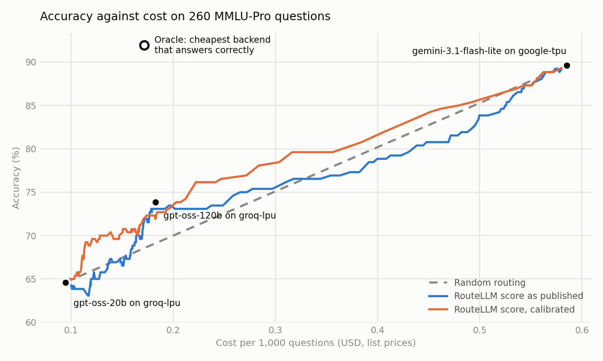

# Routing LLM queries across models and chips

[RouteLLM](https://arxiv.org/abs/2406.18665) (Ong et al., 2024) sends each query to a
strong or a weak model and shows large cost savings at nearly the same quality. It
assumes one pair of models, one price each, and ignores speed.

I wanted to see what happens with a pool closer to what you can actually rent: three
models on two chip families, each with its own accuracy, price and latency. I measured
the pool, tested RouteLLM's published router on it, and extended the routing rule to
handle any number of backends with latency as well as cost.

The short version: the pool leaves a lot of room for routing, the published router
does not find it, and a small calibration step recovers some of it but not enough to
be conclusive on 260 questions.

## The pool

260 questions from [MMLU-Pro](https://huggingface.co/datasets/TIGER-Lab/MMLU-Pro),
each answered once by every backend. Cost uses list prices. Latency is wall-clock time
for one request at a time, measured from Doha.

| Backend | Accuracy | Cost per 1,000 questions | Seconds per answer |
|---|---|---|---|
| gpt-oss-20b on Groq (LPU) | 64.6% | $0.094 | 0.79 |
| gpt-oss-120b on Groq (LPU) | 73.8% | $0.182 | 1.00 |
| gemini-3.1-flash-lite on Google (TPU) | 89.6% | $0.585 | 1.86 |
| Oracle: cheapest backend that is correct | 91.9% | $0.171 | 0.94 |

The oracle row is the ceiling. A perfect router would beat the best single backend on
accuracy at 29% of its cost, sending 71% of questions to the cheapest model.

## What I changed in the routing rule

RouteLLM's router outputs `p`, the probability that a query needs the strong model,
and routes to it when `p` passes a threshold. I kept the router and replaced the rule:

    pick the backend with the highest  quality - alpha * cost - beta * latency

`quality` is the expected chance of a correct answer from that backend, and `cost` and
`latency` are its measured averages scaled to 0..1. With two backends and `beta = 0`
this is exactly RouteLLM's threshold, which `test_hwroute.py` checks. The rule itself
does not care how many backends there are or where `quality` comes from.

I compared three sources for `quality`, all fitted on four fifths of the questions and
scored on the remaining fifth, rotating through five folds:

- **Base rates only.** Each backend's average accuracy. No per-question signal.
- **RouteLLM score as published.** The best backend is assumed always right, the
  worst fails with probability `p`, the middle one sits in between.
- **RouteLLM score, calibrated.** One logistic curve per backend, mapping the score to
  that backend's observed accuracy.

## Results

Accuracy gained over random routing at the same cost, averaged across the cost range:

| Policy | Gain (points) | 90% bootstrap interval |
|---|---|---|
| Base rates only | +0.3 | -2.2 to +3.0 |
| RouteLLM score as published | -0.3 | -2.9 to +2.3 |
| RouteLLM score, calibrated | +2.2 | -0.2 to +4.4 |

**The published router does not transfer to this pool.** Its score should be high
where weak models fail. Here it runs the other way: the score predicts a *correct*
answer from gpt-oss-20b with an AUC of 0.64, where a useful score would be well under
0.5. The likely cause is prompt length. The score correlates -0.70 with log prompt
length, so short questions look hard to it and long ones look easy. In MMLU-Pro the
short questions are mostly maths, where the small models score 90 to 100%, and the
long ones are law, where gpt-oss-20b scores 27%. The paper reports that routers trained
on chat data are weak on this kind of benchmark, and this is the same effect.

**Calibration fixes the direction but the gain is small.** Fitting the score against
each backend's own results learns the sign and gives +2.2 points over random. The
interval includes zero, so I would not claim it works on this evidence.

**Latency and cost push the same way here.** The cheapest backend is also the fastest
and the most accurate is the slowest, so raising `beta` moves along the same frontier
as raising `alpha`:

| beta | Accuracy | Seconds per answer | Share to 120b / 20b / Gemini |
|---|---|---|---|
| 0 | 89.6% | 1.86 | 0% / 0% / 100% |
| 0.25 | 84.2% | 1.65 | 26% / 0% / 74% |
| 0.5 | 73.8% | 1.00 | 100% / 0% / 0% |
| 1 | 71.2% | 0.96 | 82% / 18% / 0% |

The latency term would earn its place in a pool where a fast chip costs more than a
slow one. I could not get one on a free tier.

## What I tried that is not in the tables

- **MMLU instead of MMLU-Pro.** On 300 MMLU questions the two Groq models scored 85.7%
  and 82.0%. With under four points between them there was nothing to route, so I moved
  to the harder benchmark. The data is in `data-mmlu/`.
- **Other signals for `quality`.** Logistic regression on the router's 768 encoder
  features, and on the MMLU-Pro subject label. Both landed between +1.3 and +1.5 points
  with intervals including zero. I report the calibrated score because it is the
  simplest, but I chose it after seeing all three, which flatters it.
- **Other backends.** Cerebras needs a card for its free tier. NVIDIA's trial API had
  retired gpt-oss-120b and took 3 to 60 seconds per answer for gpt-oss-20b.
  gemini-3.8-flash scored 16 of 17 before the free tier cut it off at 20 requests.

## Limitations

- 260 questions is too few to separate a 2-point gain from noise. This is the main
  thing I would fix, by collecting 1,000 or more.
- One benchmark, multiple choice, graded by exact letter.
- Latency is one constant per backend, measured from one location with no concurrent
  load. It includes network time and says nothing about behaviour under load.
- The two chip families run different models, so this does not isolate the effect of
  the chip. A same-model comparison needs a second provider hosting gpt-oss-120b.
- The gpt-oss models ran with `reasoning_effort: low` to stay inside free limits.

## Run it

The answers are cached in `data/`, so the evaluation runs without API keys.

    pip install -r requirements.txt
    python test_hwroute.py     # checks the routing rule and the answer grader
    python evaluate.py         # prints the tables, writes data/results.png

To collect fresh answers, copy `.env.example` to `.env`, add free keys from Groq and
Google AI Studio, and run `python collect.py 300`. It saves each answer as it arrives
and resumes where it stopped, which matters because the free tiers run out daily.

| File | What it does |
|---|---|
| `backends.py` | One row per (model, chip): endpoint, model name, list price |
| `collect.py` | Asks every backend every question and caches the answers |
| `router.py` | RouteLLM's score, and the routing rule |
| `evaluate.py` | Replays cached answers through each policy |
| `test_hwroute.py` | Assertions for the rule and the grader |
